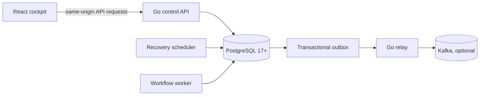

# Fathom

**Durable workflow orchestration with a live operator cockpit.** Fathom records each workflow transition in PostgreSQL, runs recoverable steps through workers, and gives operators a clear view of execution, failures, audit history, and system health.

[](https://github.com/lakhyach/fathom/actions/workflows/ci.yml)
[](https://github.com/lakhyach/fathom/actions/workflows/cdc-integration.yml)
[](LICENSE)

> Fathom is a portfolio and engineering demo, currently intended for local development. The browser app and Go control plane run end to end locally. Public hosting needs a production network and authentication review plus separately hosted API, workers, database, and event relay. A static Vercel deployment by itself would not run the workflow engine.

## What it does

- **Durable workflow state:** PostgreSQL transactions, versioned migrations, idempotent creation, and a durable audit trail.
- **Recoverable execution:** worker leases and fencing, retry scheduling, deadline handling, and dead-letter operations.
- **Protected control API:** bearer authentication, reader/operator/admin roles, rate limits, stable problem responses, and idempotency keys.
- **Operator cockpit:** overview, workflow list and detail, dead-letter queue, events and audit, metrics and health, and configuration screens.
- **Honest observability:** health/readiness endpoints and Prometheus metrics sourced from real engine and database state.
- **Optional event transport:** Kafka outbox publishing and a separate Kafka/Debezium integration smoke workflow.

The built-in `echo` participant is a deterministic **development sample** used to demonstrate workflow execution. It is not business logic or a production participant.

## Architecture



For local development, Vite proxies `/v1`, `/healthz`, `/readyz`, and `/metrics` to the loopback Go API. PostgreSQL stores workflows, step state, attempts, leases, outbox records, definitions, operator actions, and audit events. Kafka is optional for local execution, but without a broker the outbox accumulates and readiness reports `relay_lag` when it exceeds the configured age. The standalone CDC smoke stack is only a compatibility check; it is not the product deployment.

## Run locally

### Requirements

- Go `1.26.5`
- Node.js `24` and npm
- PostgreSQL `17` or later
- Docker Compose only for the optional CDC integration check

Create a local PostgreSQL database and role, then prepare the ignored environment file:

```powershell
Copy-Item .env.example .env
```

Replace the database URL and API-key placeholders in `.env` with local values. The API reads process environment variables; it does **not** parse `.env` by itself. Import the values in PowerShell and start the Go service:

```powershell
Get-Content .env | Where-Object { $_ -match '^\s*[^#][^=]*=' } | ForEach-Object {
  $name, $value = $_ -split '=', 2
  [Environment]::SetEnvironmentVariable($name.Trim(), $value.Trim(), 'Process')
}
go run ./cmd/fathom
```

The service applies embedded database migrations during startup. In another terminal, start the cockpit:

```powershell
cd web
npm ci
npm run dev
```

Open [http://127.0.0.1:5173](http://127.0.0.1:5173). In **Settings**, enter the matching key from `FATHOM_API_KEYS`. With `FATHOM_DEV_ECHO=1`, register an `echo` step definition and place a workflow to see it complete through the worker and PostgreSQL ledger.

Keep `.env` local. It is covered by `.gitignore`; never put real database passwords or API keys in source, issue reports, screenshots, or browser URLs.

## Verify changes

From the repository root:

```powershell
go test ./...
go vet ./...
go build ./...
```

For the cockpit:

```powershell
cd web
npm run typecheck
npm test
npm run lint
npm run build
```

The hosted CI workflow runs Go formatting, vet, static analysis, unit and race tests, portability builds, dependency checks, and the frontend typecheck/test/lint/build pipeline. The CDC workflow starts pinned PostgreSQL, Kafka, and Debezium containers and verifies an outbox event reaches Kafka.

## Project layout

| Path | Purpose |
| --- | --- |
| `cmd/fathom/` | Single Go entry point with `control`, `worker`, `relay`, and `all` modes |
| `internal/engine/` | Deterministic workflow state machine |
| `internal/store/postgres/` | PostgreSQL persistence, migrations, leases, outbox, and operator actions |
| `internal/worker/` | Durable step claiming and participant execution |
| `internal/scheduler/` | Retry and timeout recovery |
| `internal/api/` | HTTP control plane, authentication, RBAC, and REST handlers |
| `internal/relay/` | Outbox relay and optional Kafka publisher |
| `web/` | React 19 + TypeScript operations cockpit |
| `db/` | Embedded, versioned schema migrations |
| `deploy/` | Kafka/Debezium compatibility smoke stack (not a product deployment) |
| `docs/` | Product specification, architecture decisions, threat model, contracts, and phase validation reports |
| `.github/workflows/` | Go/frontend CI and CDC integration check |

## Runtime modes

| Mode | Runs | Requirements |
| --- | --- | --- |
| `control` | HTTP API and recovery scheduler | PostgreSQL and `FATHOM_API_KEYS` |
| `worker` | Participant worker | PostgreSQL and a registered participant |
| `relay` | Outbox-to-Kafka relay | PostgreSQL and `FATHOM_KAFKA_BROKERS` |
| `all` | Every configured local subsystem | PostgreSQL; optional Kafka and development echo participant |

The API binds to loopback by default and refuses non-loopback binding while bearer keys are the only security boundary. See [`docs/THREAT_MODEL.md`](docs/THREAT_MODEL.md) before changing deployment boundaries.

## Documentation

- [Product specification](docs/PRODUCT_SPECIFICATION.md)
- [Architecture decisions](docs/ARCHITECTURE_DECISIONS.md)
- [Workflow state machine](docs/WORKFLOW_STATE_MACHINE.md)
- [Data and API contracts](docs/DATA_AND_API_CONTRACTS.md)
- [Reliability and failure test plan](docs/RELIABILITY_AND_FAILURE_TEST_PLAN.md)
- [Observability and UI specification](docs/OBSERVABILITY_AND_UI_SPECIFICATION.md)
- [Development guide](docs/DEVELOPMENT.md)
- [Threat model and hosting gates](docs/THREAT_MODEL.md)
- [Phase 8.2 validation report](docs/PHASE_8_2_VALIDATION_REPORT.md)
- [Attribution and dependency licences](docs/ATTRIBUTION_AND_LICENSES.md)

## Licence and provenance

Released under the [MIT License](LICENSE). The repository is an original implementation. Design concepts informed by `semotpan/saga-orchestration-go` are documented in [Attribution and Licences](docs/ATTRIBUTION_AND_LICENSES.md); implementation code was written for this project.
